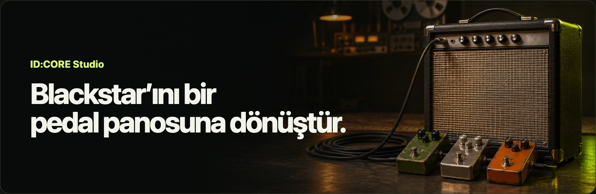
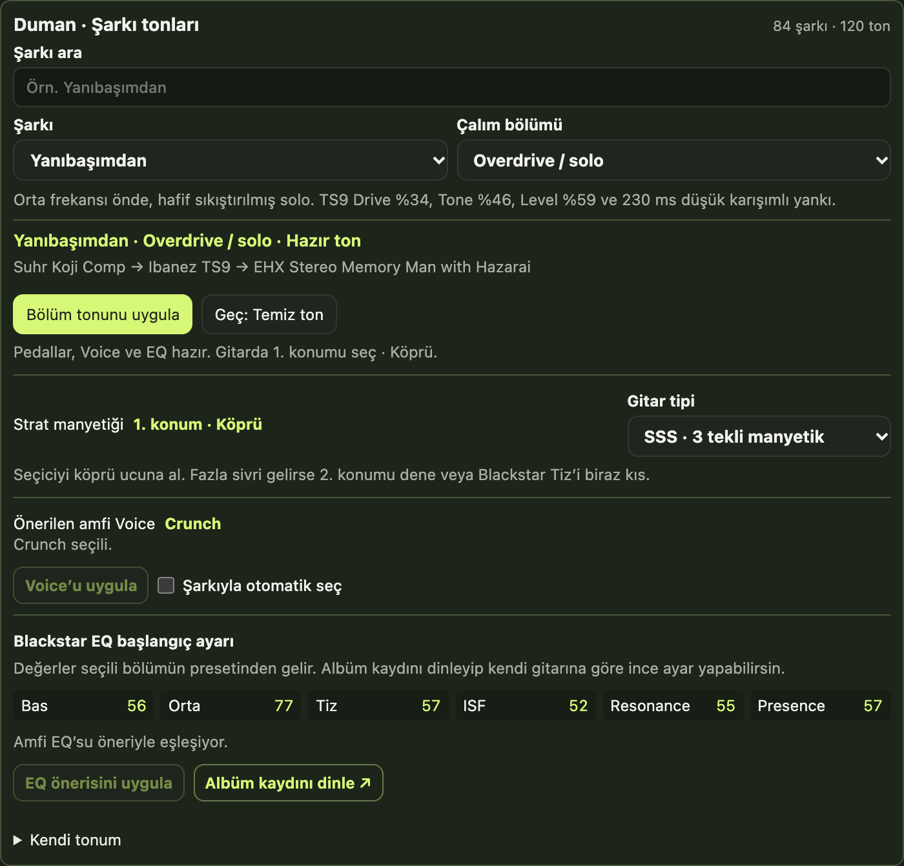
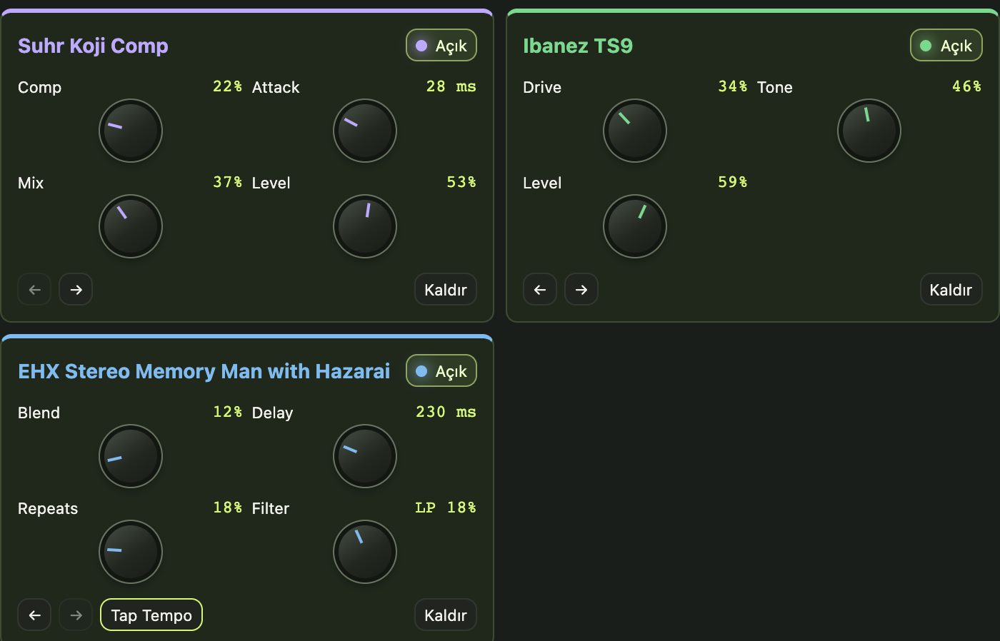
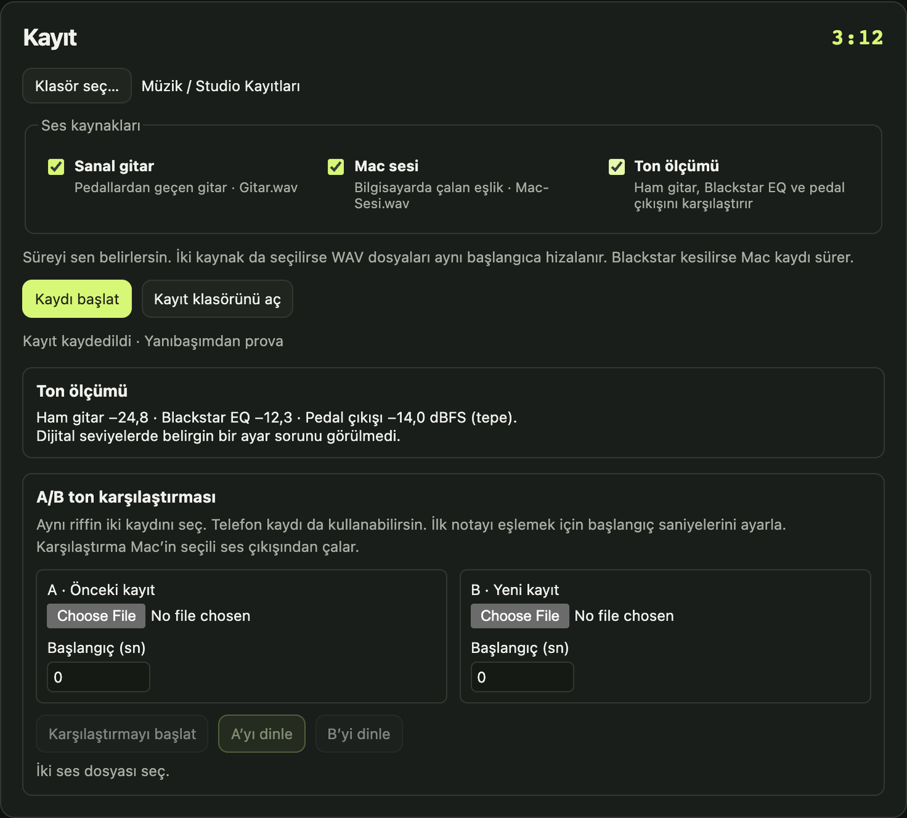

<p align="center">
  
</p>

# ID:CORE Studio

**Blackstar ID:CORE Stereo 10 V4 için macOS’te sanal pedal panosu, şarkı tonları ve kayıt.**

Blackstar’ını USB ile Mac’e bağla. Duman’dan bir şarkı seç, temiz girişten overdrive solosuna tek düğmeyle geç ve tonu amfinin kendi hoparlöründen duy. Gitarına göre yaptığın ayarı o bölüme kaydet, bir sonraki provada kaldığın yerden devam et.

**84 şarkı · 120 bölüm tonu · 12 sanal pedal**

[Kur ve ilk tonunu çal](#hızlı-başlangıç) · [Kayıt ve A/B](#kayıt-ve-ab) · [Uyumluluk](#uyumluluk-ve-testler)

## Temiz girişten soloya tek düğmeyle geç

Yanıbaşımdan’ın temiz bölümünde Strat’ta **4. konum (orta + sap)** ile başla. Solo geldiğinde **Geç** düğmesiyle TS9’lu zinciri, Crunch Voice’u ve solo EQ’sunu çağır. Studio ayarları Blackstar’dan geri okuyup doğrular ve gitarda **1. konuma (köprü)** geçmeni hatırlatır.

<p align="center">
  
</p>

Yedi stüdyo albümünde şarkı veya albüm adına göre ara. Hazır tonlar, Blackstar ve Strat için çalınabilir başlangıç ayarlarıdır. **Albüm kaydını dinle** düğmesi yayımlanmış parçayı açar. Kayıt kulak referansıdır, uygulamadaki EQ değerleri o miks üzerinden çıkarılmaz. [Duman’ın resmî diskografisi](https://dumanlive.com/albumler/grup-albumler)

**Kendi tonum olarak kaydet** ile pedal zincirini, Voice’u, EQ’yu ve kullandığın manyetik konumunu bölüm bazında Mac’inde sakla. Standart Strat seçicisinde 1 köprü, 5 sap ucudur. **SSS / HSS** seçimi köprü manyetiğine göre öneriyi uyarlar. [Fender manyetik seçici kılavuzu](https://www.fender.com/articles/instruments/sounds-aplenty-the-stratocaster-pickup-selector-switch)

## Pedallarını kur, tonu Blackstar’dan duy

Overdrive, kompresör, wah, phaser, Uni-Vibe, tremolo ve delay’i aynı zincirde kullan. Pedalları sırala, tek tek açıp kapat ve ayarları çalarken değiştir. **Clean ve drive sesini dengele** ile iki ton arasındaki seviye farkını azalt. Son dinleme seviyesini **Pedal Volume** ile ayarla.

<p align="center">
  
</p>

**Wah** elle, sürekli döngüyle veya pena vuruşuna tepki vererek çalışır. **Akort ve entonasyon** paneli Standart ve Drop D akordu ile 12. perde harmoniği ve basılı nota karşılaştırmasını içerir.

## Kayıt ve A/B

**Gitarını ve Mac’te çalan eşliği ayrı WAV dosyalarına kaydet.** Kaydı istediğin zaman durdur. İki kaynak da açıksa Studio ortak başlangıcı hizalar. Blackstar bağlantısı kesilirse gitar dosyası kapanır ve Mac kaydı devam eder.

<p align="center">
  
</p>

- **Ton ölçümü** aynı riffin ham gitar, Blackstar EQ ve pedal çıkışı seviyelerini karşılaştırır. Sonucu ekranda ve `Ton-Olcumu.txt` dosyasında gösterir.
- **A/B ton karşılaştırması** iki yerel kaydı aynı dinleme seviyesinde çalar. Bir tarafa telefonla aldığın hoparlör kaydını koyabilir, başlangıç saniyeleriyle ilk notaları hizalayabilirsin. A/B, Mac’in seçili ses çıkışını kullanır.

<sub>Arayüz görselleri Studio 0.16’dan alındı ve örnek veriler kullanıyor.</sub>

## Hızlı başlangıç

Blackstar ID:CORE Stereo 10 V4, veri aktarabilen bir USB kablosu ve **macOS 12 veya sonrası** gerekir. Derleme için **macOS 14.2 veya daha yeni SDK içeren Xcode Command Line Tools** kullan. Mac’te çalan eşliği ayrıca kaydetmek için macOS 14.2 veya sonrası ve sistem sesi kaydı izni gerekir.

```sh
git clone https://github.com/alikorogluts/idcore-studio.git
cd idcore-studio
./Scripts/build.sh
open "build/IDCORE Studio.app"
```

1. Blackstar’ı açıp USB ile bağla. **USB ile bağlan → Sanal pedalları aç** düğmelerini kullan. macOS sorarsa USB gitar girişini okuyabilmesi için mikrofon izni ver.
2. Bir şarkı ve bölüm seç. Blackstar’ın **MANUAL** ışığı yanarken **Bölüm tonunu uygula** düğmesine bas.
3. Sanal pedalları tek başına duymak için **Doğrudan sesi kıs**. **Pedal Volume**’ü düşükten başlayarak artır. Amfinin kendi gitar sesine dönmek için **Doğrudan sesi geri aç**.

Bağlantı açılmıyorsa Blackstar Architect’i kapatıp yeniden dene. Ses dönüşünü kontrol etmek için **USB çıkışını dene** düğmesi Blackstar’a kısa bir ton gönderir.

## Uyumluluk ve testler

| | Durum |
| --- | --- |
| **Amfi** | Blackstar ID:CORE Stereo 10 V4 üzerinde denendi. |
| **Canlı ses** | Blackstar ön katı → Mac’te sanal pedallar → USB ile Blackstar hoparlörleri. |
| **Gecikme** | Denenen Blackstar kurulumunda 48 kHz ve 128 örnekte Core Audio USB giriş–çıkış tahmini **7,9 ms**. |
| **Kayıt** | Bağlı amfide **3 dakika 12 saniye** gitar ve Mac sesi kaydı doğrulandı. |
| **Sahne** | Bağlı amfide Yanıbaşımdan’ın temiz tonundan solosuna geçiş doğrulandı. Tam set provası ve fiziksel USB kopma testi bekliyor. |

```sh
./Scripts/test.sh
```

<details>
<summary>Teknik yapı ve kaynaklar</summary>

- `Sources/IDCOREStudio.swift` macOS uygulamasını ve USB HID iletişimini yönetir.
- `Sources/StudioAudio.c` Core Audio, pedal işleme, akort ve kayıt tamponunu içerir.
- `Sources/StudioRecording.swift` ve `Sources/StudioSystemAudio.swift` WAV yazımı ve isteğe bağlı Mac sesi kaydını yönetir.
- `Resources/studio-assets` şarkı tonlarını, pedal kontrollerini ve arayüzü içerir.
- Blackstar’ın USB kanal 3’ü ön kat sinyalini sağlar. Studio sanal zincirin dönüşünü USB 1/2’ye gönderir. [Blackstar ID:CORE V4 kılavuzu](https://www.blackstaramps.com/wp-content/uploads/2024/01/155300M-VA-1-IDCORE-V4-OWNERS-MANUAL.pdf) · [ASTRO Blackstar USB protokolü](https://github.com/SirYasko/ASTRO-Blackstar)
- Pedal modelleri orijinal cihazlardan esinlenir. [Ibanez TS9](https://www.ibanez.com/usa/products/detail/ts9_99.html) · [EHX Germanium OD](https://www.ehx.com/wp-content/uploads/2021/01/germanium-od-manual.pdf) · [Suhr Koji Comp](https://www.suhr.com/wp-content/uploads/2016/10/Koji-User-Guide.pdf) · [EHX Stereo Memory Man](https://www.ehx.com/wp-content/uploads/2020/11/stereo-memory-man-with-hazarai.pdf)

</details>

<sub>ID:CORE Studio bağımsız bir projedir. Blackstar, Fender, Duman ve pedal markalarının adları uyumluluk, ton referansı ve model açıklamaları için kullanılır.</sub>
